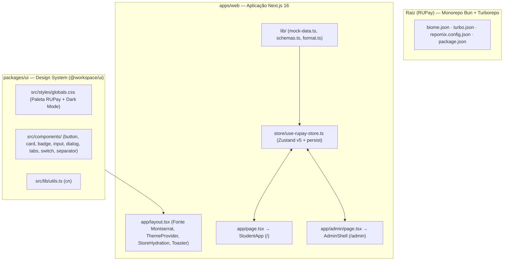
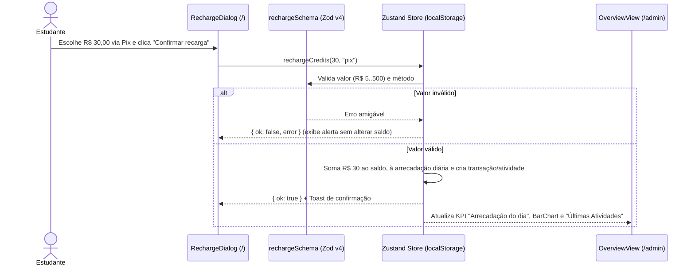

# Arquitetura do Frontend — RUPay & RU Gestão

> Guia completo e acessível explicando **como este aplicativo foi construído**, **o que cada tecnologia faz** e **como cada arquivo conversa com o outro** — escrito para quem está começando do zero em Frontend.

---

## 1. O que é este projeto e como funciona sem Backend?

O **RUPay** é uma plataforma web para o **Restaurante Universitário (RU)** da **Universidade Nova Paulista** com duas interfaces sincronizadas dentro do mesmo site:

1. **App do Estudante (`/`) — RUPay**: pensado para celular (*mobile-first*). Permite ver saldo disponível, recarregar créditos (Pix, Cartão ou Boleto simulados), conferir o **cardápio atual publicado** (Almoço, Jantar e Lanche), registrar passagem no bandejão, consultar histórico financeiro, ler comunicados e acompanhar métricas de sustentabilidade (copos plásticos e folhas de papel economizados).
2. **Painel Administrativo (`/admin`) — RU Gestão**: pensado para computador (*desktop*). Permite acompanhar indicadores em tempo real (refeições servidas, arrecadação do dia, tempo de fila, satisfação), analisar gráficos interativos, **criar/editar/publicar o cardápio**, lançar recargas manuais, cadastrar ou bloquear usuários, enviar avisos aos estudantes e exportar relatórios em CSV.

### Como os dois lados conversam sem um servidor/banco de dados?

Em um sistema completo, o Frontend (a tela no navegador) envia e busca dados em um **Backend** (um servidor com banco de dados). Como esta etapa foca **apenas no Frontend**, simulamos um "mini banco de dados" dentro do próprio navegador usando o **`localStorage`** gerenciado pelo **Zustand**.

Isso significa que, na mesma máquina/navegador:
- Quando você faz uma recarga ou passa no bandejão em `/`, o **Painel `/admin`** atualiza imediatamente os números de arrecadação, refeições e "Últimas Atividades".
- Quando o administrador publica um prato novo ou envia um comunicado em `/admin`, o **App do Estudante `/`** passa a exibir o cardápio atualizado e o sininho de notificação na hora.

---

## 2. Glossário das Tecnologias Usadas (do zero)

| Tecnologia | Versão no projeto | O que faz na prática (analogia simples) |
|---|---|---|
| **Bun** | `1.4.4` | É o motor e instalador de pacotes: baixa bibliotecas (`bun add`), roda o site (`bun dev`) e executa testes automatizados (`bun test`). |
| **Turborepo** | `2.11.11` | Organiza o **Monorepo** (vários projetos juntos em uma pasta só). Permite rodar `build`, `lint` e `typecheck` em `apps/` e `packages/` com um único comando. |
| **Next.js (App Router)** | `16.4.6` | O "esqueleto" do site. Transforma pastas dentro de `apps/web/app/` em páginas reais (`app/page.tsx` vira `/` e `app/admin/page.tsx` vira `/admin`). |
| **React** | `19.3.1` | Permite construir a tela em pedaços reutilizáveis chamados **componentes** (ex.: um botão, um cartão de saldo, uma janela de recarga). |
| **TypeScript** | `5` | Um "corretor automático" do JavaScript que avisa antes de o código rodar se você escreveu um nome errado ou passou texto onde deveria ir número. |
| **Tailwind CSS v4** | `4` | Sistema de estilo por classes curtas direto no HTML/JSX (ex.: `bg-primary`, `rounded-2xl`, `p-4`), conectado às variáveis de cor em `globals.css`. |
| **Shadcn UI + Base UI** | `4.23.0` / `1.9.0` | Componentes prontos e acessíveis (`Dialog`, `Tabs`, `Switch`, `Button`, `Card`). Neste projeto o Shadcn usa **Base UI** (`@base-ui/react`), cuidando de acessibilidade (teclado, foco, tecla `Esc`). |
| **Hugeicons** | `1.1.10` / `4.4.0` | Biblioteca de ícones vetoriais modernos (`Home01Icon`, `Restaurant01Icon`, `Leaf01Icon`, etc.). |
| **Zustand** | `5.1.0` | O "quadro de avisos central" na memória do navegador. Guarda saldo, cardápios, usuários e avisos, salvando automaticamente no `localStorage`. |
| **Zod** | `4.6.7` | O "fiscal de formulários". Antes de aceitar uma recarga ou novo cardápio, checa se os valores estão dentro das regras (ex.: recarga entre R\$ 5 e R\$ 500). |
| **Recharts** | `3.11.1` | Transforma listas de números em gráficos interativos SVG (gráfico de área, rosca e barras) no Painel Administrativo. |
| **Sonner** | `2.0.8` | Exibe aquelas notificações rápidas no topo da tela (*toasts*) dizendo `"Recarga confirmada!"` ou `"Cardápio salvo!"`. |
| **Biome** | `2.6.6` | Padroniza a formatação (tabs, aspas duplas, ordem dos `import`s) e aponta erros de acessibilidade ou lógica. |
| **Repomix** | `repomix.config.json` | Empacota a estrutura do código em um arquivo único para facilitar análise completa da arquitetura. |

---

## 3. Arquitetura Geral do Projeto (Visão em Blocos)

O repositório é dividido em **duas pastas principais**:

- **`packages/ui/`**: a **caixa de peças visuais reutilizáveis** (cores da marca, botões, cartões, janelas modais, abas, interruptores).
- **`apps/web/`**: a **aplicação web real** que junta essas peças, os dados simulados e as regras de negócio para formar `/` e `/admin`.

---

## 4. Paleta de Cores e Tipografia

Toda a identidade visual foi extraída das referências em `model/TelaMobile-Paleta.jpeg` e `model/TelaADM.jpeg` e centralizada em `packages/ui/src/styles/globals.css`:

- **Verde Floresta** (`--primary`, `--sidebar`): `#0B4F22` — barra lateral do admin, cabeçalho curvo do estudante e botões principais.
- **Verde Sustentável** (`--ring`, `--chart-2`): `#5FA927` — destaques ecológicos, valores positivos de recarga e indicadores.
- **Verde Menta / Sálvia** (`--accent`, `--secondary`): `#DFF0D2` / `#EBF4E3` — fundos suaves de ações rápidas e banners sustentáveis.
- **Creme Universitário** (`--background`, `--card`): `#F7F4EA` (fundo geral) e `#FCFBF7` (cartões elevados) — leitura confortável e visual acolhedor.
- **Terracota Suave** (`--destructive`): `#C94A1E` — valores negativos (consumo no bandejão) e alertas de erro.
- **Fontes (`apps/web/app/layout.tsx`)**: **Montserrat** (`400`, `500`, `600`, `700`) para títulos e textos, e **Geist Mono** com `tabular-nums` para que valores como `R$ 42,50` e `R$ 18.430,00` fiquem sempre alinhados sem "tremer".

---

## 5. Mapa Completo de Pastas e Arquivos

### A. Design System (`packages/ui/src/`)
| Arquivo | Responsabilidade |
|---|---|
| `styles/globals.css` | Define tokens de cor do tema claro (Creme) e tema escuro (`.dark`), raios de borda e estilos base do Tailwind v4. |
| `components/button.tsx` | Botão base (`@base-ui/react/button`) com variantes (`default`, `outline`, `secondary`, `ghost`, `destructive`, `link`) e tamanhos. |
| `components/card.tsx` | Estrutura padrão de cartão (`Card`, `CardHeader`, `CardTitle`, `CardDescription`, `CardAction`, `CardContent`, `CardFooter`). |
| `components/badge.tsx` | Etiquetas em pílula (`default`, `secondary`, `success`, `destructive`, `outline`) usadas em status de cardápio, alérgenos e avisos. |
| `components/input.tsx` | Campos `Input` e `Textarea` padronizados com bordas suaves e anel de foco verde. |
| `components/dialog.tsx` | Janela modal acessível (`@base-ui/react/dialog`) com fundo escurecido, botão de fechar e proteção `grid-cols-1 overflow-x-hidden`. |
| `components/tabs.tsx` | Abas acessíveis (`@base-ui/react/tabs`) para alternar entre `Pix / Cartão / Boleto` ou `Almoço / Jantar / Lanche`. |
| `components/switch.tsx` | Interruptor liga/desliga (`@base-ui/react/switch`) usado nas configurações de tema e publicação de cardápio. |
| `components/separator.tsx` | Linha divisória horizontal/vertical (`@base-ui/react/separator`). |

### B. Camada de Dados, Regras e Estado (`apps/web/`)
| Arquivo | Responsabilidade |
|---|---|
| `lib/format.ts` | Formata moeda (`formatBRL`), inteiros (`formatInt`), datas/horas no fuso `America/Sao_Paulo` e arredonda centavos (`roundCents`) para evitar erros como `42.5 + 30.1 = 72.60000000000001`. |
| `lib/schemas.ts` | Define todos os contratos de validação com **Zod v4** (`rechargeSchema`, `manualRechargeSchema`, `menuEntrySchema`, `announcementSchema`, `newUserSchema`, `feedbackSchema`, `settingsSchema`). |
| `lib/mock-data.ts` | Contém os tipos TypeScript e o objeto `INITIAL_RUPAY_DATA` com o estado inicial fiel às telas de referência (saldo `R$ 42,50`, `4.820` refeições, `R$ 18.430,00`, 3 cardápios, 8 usuários, 3 avisos, 3 feedbacks). |
| `store/use-rupay-store.ts` | Store **Zustand v5** com middleware `persist` (`rupay-store-v1`, `skipHydration: true`). Concentra todas as ações (`rechargeCredits`, `consumeMeal`, `saveMenu`, `toggleMenuPublished`, `sendAnnouncement`, `submitFeedback`, `addUser`, `toggleUserStatus`, `adminManualRecharge`, `updateSettings`, `updateStudentPrefs`, `resetDemoData`). |
| `components/store-hydration.tsx` | Componente invisível montado no `layout.tsx` que chama `useRupayStore.persist.rehydrate()` apenas no navegador após a primeira renderização. |
| `store/use-rupay-store.test.ts` | Suíte com **10 testes unitários** (`bun test`) validando limites Zod, matemática de centavos, bloqueio por saldo insuficiente e sincronização entre ações. |

### C. Interface do Estudante (`apps/web/app/page.tsx` + `apps/web/components/student/`)
| Arquivo | O que o usuário vê e faz |
|---|---|
| `student-app.tsx` | Moldura mobile (`max-w-[430px]` centralizada no desktop com switcher para `/admin`), barra inferior fixa (`Início`, `RU`, `Conta`) e roteamento interno de sub-telas. |
| `home-view.tsx` | Cabeçalho curvo Verde Floresta com sino de notificações, cartão elevado com **Saldo disponível** e botão **Recarregar**, atalhos (`Histórico`, `RU Sustentável`, `Configurações`), prévia do cardápio e banner sustentável. |
| `recharge-dialog.tsx` | Modal de recarga com valores rápidos (`R$ 15` a `R$ 100`), valor livre, abas `Pix` (com código Copia e Cola simulado), `Cartão` e `Boleto`. |
| `menu-ru-view.tsx` | Aba **RU**: exibe o cardápio atual publicado (`Almoço`, `Jantar`, `Lanche`), opção vegana, calorias, alérgenos, status da fila, botão **Passar no Bandejão** (debita saldo) e formulário de avaliação por estrelas. |
| `history-view.tsx` | Lista de movimentações filtrável por `Todas`, `Recargas` e `Consumos`, mais banner calculando copos plásticos evitados. |
| `sustainable-view.tsx` | Tela **RU Sustentável** com globo ilustrado (`EcoGlobeIllustration`), 3 pilares de impacto e métricas pessoais acumuladas. |
| `notifications-view.tsx` | Caixa de entrada dos comunicados enviados pelo admin, com selo verde nos não lidos e botão "Marcar todas como lidas". |
| `account-view.tsx` | Aba **Conta**: carteirinha digital com QR simbólico do RA, interruptor de modo escuro, preferências de aviso, link para `/admin` e botão para restaurar os dados iniciais. |

### D. Painel Administrativo (`apps/web/app/admin/page.tsx` + `apps/web/components/admin/`)
| Arquivo | O que o gestor vê e faz |
|---|---|
| `admin-shell.tsx` | Barra lateral Verde Floresta (`RU Gestão`) com 7 seções + drawer responsivo no mobile, card `"Sustentabilidade em foco!"` e barra superior com atalho para o App Estudante (`/`). |
| `overview-view.tsx` | Visão Geral fiel à referência: 4 cards KPI ao vivo, **Ações Rápidas** 2×2, 3 gráficos **Recharts** (*Movimentação do RU*, *Distribuição das Refeições*, *Resumo Financeiro*) e feed **Últimas Atividades**. |
| `menu-manager-view.tsx` | Gestão e **Publicação do Cardápio Atual**: alterna `Publicado` / `Rascunho` e edita todos os itens do prato (com opção de notificar estudantes automaticamente). |
| `payments-view.tsx` | Histórico global de entradas/saídas, filtros de tipo/busca e modal de **Recarga Manual** em qualquer conta cadastrada. |
| `users-view.tsx` | Lista pesquisável de estudantes, bolsistas e servidores com recarga rápida (`+ R$ 20`), bloqueio/desbloqueio e cadastro de novo usuário. |
| `notifications-view.tsx` | Envio de comunicados instantâneos para o App Estudante e painel de avaliações recebidas. |
| `reports-view.tsx` | Resumo operacional, impacto ambiental agregado do campus e botão **Exportar CSV** direto no navegador. |
| `settings-view.tsx` | Configuração de preços por refeição, status/tempo de fila, horário de funcionamento, modo escuro e restauração dos dados demo. |

### E. Identidade Visual e Layout Raiz (`apps/web/`)
| Arquivo | Papel |
|---|---|
| `components/brand/rupay-logo.tsx` | SVGs vetoriais desenhados sob medida: `RupayLogo` (garfo + folha), `RuGestaoLogo` (talheres no círculo) e `EcoGlobeIllustration` (planeta com folhas), usando `useId()` para evitar colisão de gradientes. |
| `components/theme-provider.tsx` | Gerencia tema claro/escuro (`next-themes`) e atalho de teclado `d`. |
| `app/layout.tsx` | Envolve toda a aplicação com as fontes `Montserrat` e `Geist_Mono`, `ThemeProvider`, `StoreHydration` e `Toaster` (`sonner`). |

---

## 6. Como os dados fluem na prática (Passo a Passo)

### Fluxo A — Estudante recarrega créditos e o Admin vê ao vivo

### Fluxo B — Por que usamos `skipHydration: true` no Zustand?

No **Next.js App Router**, a página é pré-renderizada inicialmente no servidor (onde **não existe `localStorage`**). Se o Zustand tentasse ler o `localStorage` imediatamente na primeira renderização do navegador, o HTML do servidor (`R$ 42,50`) poderia divergir de um saldo salvo no navegador (`R$ 72,50`), causando erro de **hidratação** no React.

Solução aplicada em 2 passos:
1. Em `store/use-rupay-store.ts`, ativamos `skipHydration: true` e um wrapper seguro (`safeStorage`) que checa `typeof localStorage !== "undefined"`.
2. Em `components/store-hydration.tsx`, um `useEffect` chama `useRupayStore.persist.rehydrate()` logo após o navegador montar a página.

Da mesma forma, em `components/admin/overview-view.tsx`, os gráficos Recharts usam `useSyncExternalStore` (`useIsMounted`) para só montar o `ResponsiveContainer` quando já existe janela real no navegador.

---

## 7. Como um Bug Real de Mobile foi Encontrado e Corrigido

Durante o teste automatizado no navegador real em largura de celular (`390×844`), identificamos que a janela **Recarregar Créditos** estourava horizontalmente para `887px`:
- **Causa raiz**: O `DialogContent` usa CSS Grid (`grid`) e, por padrão do CSS, colunas de grid (`min-width: auto`) se esticam se houver uma string longa sem espaços — no caso, o código simulado de **Pix Copia e Cola**.
- **Correção cirúrgica (`packages/ui/src/components/dialog.tsx` e `apps/web/components/student/recharge-dialog.tsx`)**:
  1. Adicionamos `grid-cols-1 overflow-x-hidden max-h-[90dvh] overflow-y-auto` no `DialogContent` base.
  2. Aplicamos `min-w-0` nos containers internos (`form`, `Tabs`, `TabsContent`) e `break-all whitespace-normal` no código Pix, quebrando a linha dentro do card.
  3. Re-testamos em `390×844` e confirmamos o modal contido em `358.4px` e clique direto funcional no botão **Confirmar recarga**.

---

## 8. Como Evoluir para um Backend Real no Futuro

Como toda regra de negócio está concentrada nas ações de `apps/web/store/use-rupay-store.ts`, você **não precisa refazer nenhuma tela** para ligar um Backend (Next.js Route Handlers, Fastify, NestJS, Supabase ou PostgreSQL):

1. Mantenha os schemas de `apps/web/lib/schemas.ts` — eles já podem ser reutilizados diretamente no servidor para validar requisições HTTP.
2. Em cada ação do Zustand (ex.: `rechargeCredits`, `consumeMeal`, `saveMenu`, `sendAnnouncement`), troque a atualização local por uma chamada `await fetch("/api/...")` e atualize o estado da store com a resposta do servidor.
3. Adicione autenticação universitária (login institucional/SSO) para separar a sessão do estudante da sessão do gestor em `/admin`.

---

## 9. Comandos Essenciais do Projeto

Execute a partir da raiz `f:\GitHub\RUPay` (ou `apps/web` no caso de `bun test`):

| Objetivo | Comando |
|---|---|
| Rodar o aplicativo em desenvolvimento | `bun run dev` (abre `http://localhost:3000` e `/admin`) |
| Rodar os testes unitários da store | `bun test` (dentro de `apps/web`) |
| Checar formatação, imports e acessibilidade | `bunx biome check apps/web packages/ui` |
| Corrigir formatação automaticamente | `bunx biome check --write apps/web packages/ui` |
| Checar tipos TypeScript em todo o monorepo | `bun run typecheck` |
| Gerar build de produção | `bun run build` |
